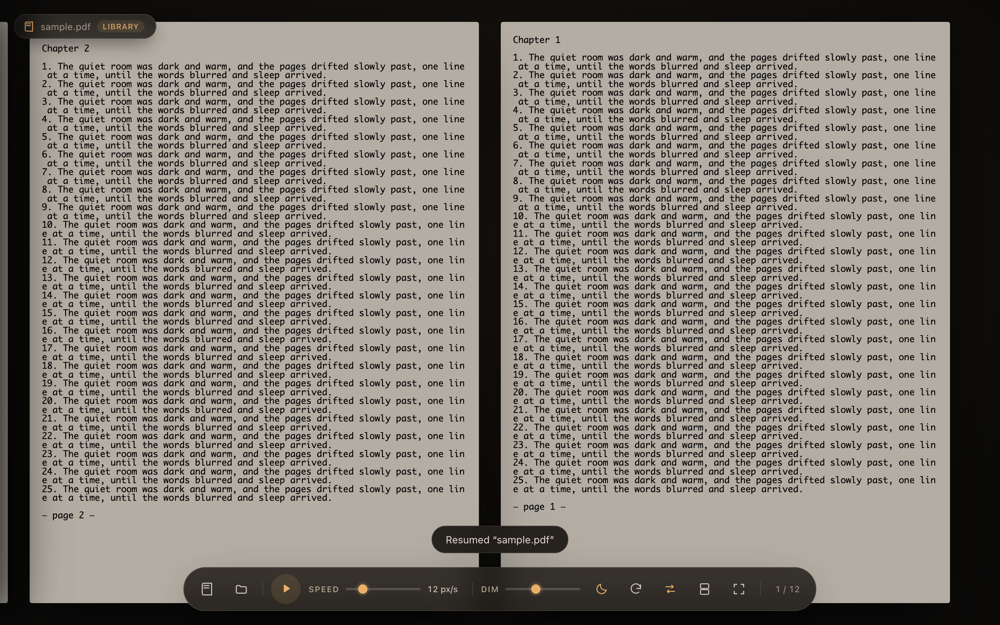
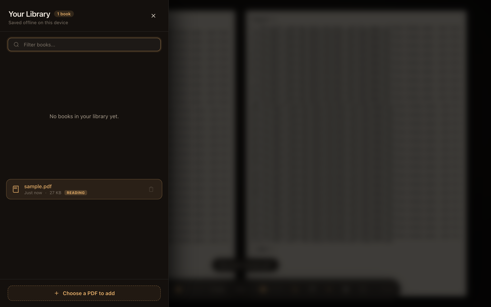
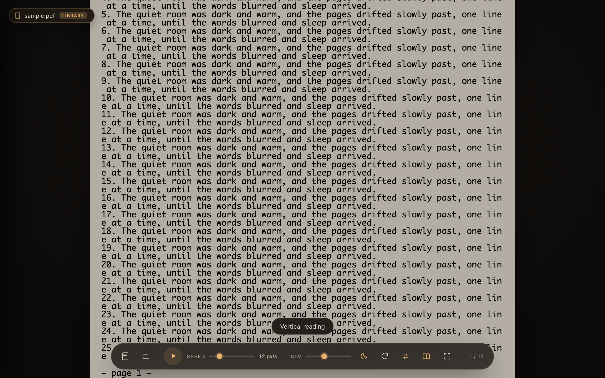
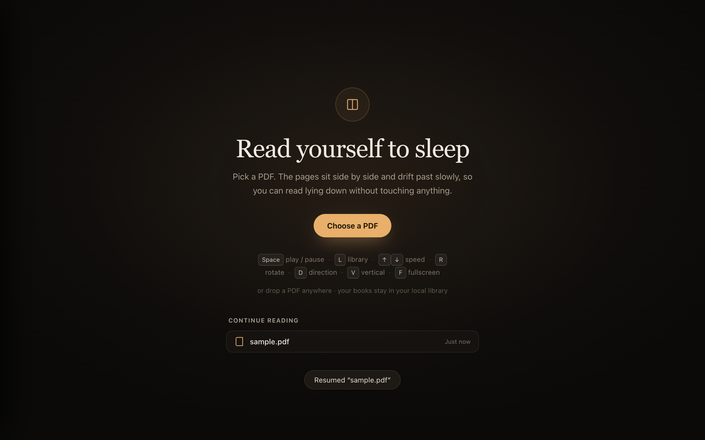

# Sleeping Reader

A local, distraction-free PDF reader designed for effortless reading in bed. Pages drift past at a gentle pace with zero clicks or page turns — just read until you fall asleep.



---

## Features

- **Dual Reading Modes**:
  - **Horizontal Mode**: Pages sit side-by-side and drift smoothly across the screen.
  - **Vertical Mode**: Continuous top-to-bottom reading with custom fluid sizing. Press `V` to switch anytime.
- **Offline Library**: All opened books are automatically saved in local IndexedDB. Switch between books instantly without re-uploading. Press `L` or click the top-left document badge.
- **Direct URL Routing**: Each book has its own clean URL (e.g. `http://localhost:5173/sample`). Bookmark or share URLs directly to resume that specific book.
- **Smart Per-Book Progress**: Remembers your exact reading position, speed, night light, rotation, and reading mode for every book individually.
- **Installable PWA**: Install as a standalone desktop app on macOS or add to the iPad/iPhone Home Screen for a native, distraction-free experience.
- **Night-Reading Visuals**: Adjustable screen dimming (up to 90%) and warm sepia lighting for pitch-black rooms.
- **90° Sideways Rotation**: Read lying on your side with the Mac or iPad.
- **Screen Wake Lock**: Automatically prevents your screen from sleeping while auto-scrolling.

---

## Screenshots

| Offline Library Drawer | Vertical Reading Mode |
|:---:|:---:|
|  |  |

| Continue Reading & Start Screen |
|:---:|
|  |

---

## Getting Started

```bash
npm install
npm run dev
```

Then open <http://127.0.0.1:5173>.

Or double-click **Sleeping Reader.command** on macOS (it installs dependencies the first time, starts the server, and opens your browser automatically).

---

## Controls & Shortcuts

| Key / Control | Action |
| --- | --- |
| `Space` / Click page | Play / Pause auto-drift |
| `V` | Switch reading mode (Horizontal ⇄ Vertical) |
| `L` / Click title badge | Open / Close Library drawer |
| `↑` `↓` | Increase / decrease auto-drift speed |
| `←` `→` | Jump backward / forward one screen |
| `R` | Rotate pages 90° (sideways). `Shift` + `R` rotates back |
| `D` | Flip drift direction (Left ⇄ Right) |
| `G` / Click page counter | Jump to a specific page number |
| `N` | Toggle warm night light |
| `F` | Toggle fullscreen mode |
| `O` | Open another PDF |
| `Esc` | Close Library drawer or Jump-to-page dialog |
| Drag & Drop | Drop any PDF anywhere to start reading |

---

## Installing as an App (PWA)

### macOS (Chrome, Edge, or Brave)
1. Open <http://127.0.0.1:5173>.
2. Click the **Install** icon in the address bar (or menu `⋮` → **Install Sleeping Reader**).
3. The app opens in its own window without browser chrome and can be kept in the macOS Dock.

### iPad & iPhone (Safari)
1. Ensure the iPad is on the same Wi-Fi as your Mac.
2. In Safari, navigate to `http://<mac-ip>:5173`.
3. Tap the **Share** button → **Add to Home Screen**.
4. Tap the icon on your home screen for full-screen edge-to-edge reading.

---

## Build for Production

```bash
npm run build
npm run preview
```

Static production files will be built to `dist/`.

---

## Privacy & Security

Everything runs locally in your browser. PDFs are stored in local IndexedDB storage on your device only — no files or data are ever transmitted to any external server.

